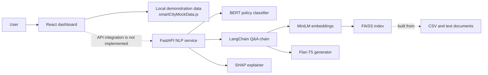

# Smart City Digital Twin

A hackathon prototype for exploring urban mobility, air quality, and energy indicators through a React dashboard, with a Python NLP service for policy classification, dataset question answering, and token-level explanations.


## Features

- Switch between Morning, Afternoon, and Evening dashboard views.
- View demonstration traffic velocity, air quality, grid load, trend, insight, and traffic-chart values.
- Classify policy queries into five intervention categories with a fine-tuned BERT model.
- Submit single or batch classification requests.
- Ask natural-language questions over a FAISS index using retrieval-augmented generation (RAG).
- Request SHAP-based token attribution for policy text and Q&A context.
- Inspect OpenAPI documentation served by FastAPI.

## Architecture



### Repository layout

```text
dashboard/                  React dashboard (Create React App)
  src/components/           Dashboard panels and cards
  src/data/                 In-code demonstration data
  src/pages/                Dashboard page
datasets/                   CSV and GeoJSON source datasets
models/
  data/                     Policy training-data generator and labels
  policy_bert/              Fine-tuned BERT checkpoint and tokenizer
nlp/                        FastAPI service, model, RAG and SHAP code
  faiss_index/               Saved FAISS index files
  tests/                     API tests (mock the classifier)
plan.md                     This documentation draft
```

## Technologies

| Area | Technologies present in the codebase |
| --- | --- |
| Dashboard | JavaScript, React 19, Create React App, Tailwind CSS, Framer Motion, Lucide React, Recharts |
| API | Python, FastAPI, Uvicorn, Pydantic, Pydantic Settings |
| Classification | PyTorch, Hugging Face Transformers, BERT sequence classification, Safetensors |
| Retrieval and Q&A | LangChain (LCEL), LangChain Community, LangChain Hugging Face, Sentence Transformers (`all-MiniLM-L6-v2`), FAISS, `google/flan-t5-base` |
| Explainability | SHAP |
| Data and artifacts | CSV, GeoJSON, JSONL, Jupyter notebooks |
| API checks | Pytest, HTTPX, FastAPI TestClient |

## Prerequisites

- Node.js and npm compatible with the installed Create React App toolchain.
- Python 3.11 (the repository's `.python-version` specifies `3.11.9`).
- Sufficient disk space and memory for PyTorch, the saved BERT checkpoint, embedding model, and Flan-T5. The first Q&A initialization may download Hugging Face model files. PyTorch uses CUDA when available and otherwise CPU.

## Setup and run

Run each service in its own terminal from the repository root.

### Dashboard

```bash
cd dashboard
npm install
npm start
```

Create React App serves the dashboard at `http://localhost:3000` by default. The values displayed are hard-coded demonstration data; starting the API does not change them.

### NLP API

The Python modules use local imports and `nlp/config.py` sets the FAISS path to `./faiss_index`. Start Uvicorn with `nlp/` as the working directory:

```bash
cd nlp
python3.11 -m venv .venv
source .venv/bin/activate
python -m pip install --upgrade pip
python -m pip install -r requirements.txt
uvicorn main:app --reload --host 127.0.0.1 --port 8000
```

The service expects the checkpoint at `models/policy_bert/` relative to the project root. The checked-in `config.json`, tokenizer files, and `model.safetensors` provide that checkpoint. The checked-in FAISS files live at `nlp/faiss_index/`, matching the command's working directory.

On startup, the API loads the classifier, Q&A chain (embedding model, FAISS index, and generator), and SHAP explainer. Startup therefore requires all of these artifacts/dependencies and may take time, especially on CPU or during the first model download. The checked-in FAISS index can be used directly; rebuild it only after changing the indexed source documents.

> **Dependency note:** `nlp/data_loader.py` imports `langchain_text_splitters`, but that package is not listed in `nlp/requirements.txt`. Add/install a compatible `langchain-text-splitters` package if rebuilding the index. The existing index avoids running the loader for ordinary API startup.

### Rebuild the retrieval index (optional)

The loader scans its configured data directory for `.txt` and `.csv` files, converts CSV rows to documents, chunks them, and writes the index at `nlp/faiss_index/` when run from `nlp/`.

```bash
cd nlp
python data_loader.py
```

`DATA_DIR` defaults to the repository's `datasets/` directory. GeoJSON files are present in `datasets/`, but the current loader does not ingest them. To override settings, use the Pydantic Settings environment variables (for example, `DATA_DIR` and `FAISS_INDEX_PATH`); relative paths are interpreted from the process working directory.

## API reference

With the API running, open [`http://127.0.0.1:8000/docs`](http://127.0.0.1:8000/docs) for interactive Swagger documentation. The API routes implemented in `nlp/main.py` and `nlp/routers/nlp_router.py` are:

| Method | Path | Purpose |
| --- | --- | --- |
| `GET` | `/health` | Classifier readiness, device, and labels |
| `GET` | `/labels` | Label names and integer IDs |
| `POST` | `/predict` | Classify one query (5–512 characters) |
| `POST` | `/predict/batch` | Classify up to 32 queries |
| `POST` | `/api/v1/nlp/qa` | Ask over retrieved city data; optional explanation flag |
| `POST` | `/api/v1/nlp/explain/policy` | Explain policy classification with SHAP |
| `POST` | `/api/v1/nlp/explain/qa` | Explain Q&A against supplied context |
| `POST` | `/api/v1/nlp/explain/tokens` | Return token importance across labels |
| `GET` | `/api/v1/nlp/health` | NLP subsystem status |

Example request:

```bash
curl -X POST http://127.0.0.1:8000/predict \
  -H 'Content-Type: application/json' \
  -d '{"query":"Reduce the speed limit near the school zone"}'
```

The classifier labels are `congestion_charge`, `lane_closure`, `public_transport_increase`, `signal_retiming`, and `speed_limit_reduction`.

## Design decisions

- **Preloaded inference models:** The classifier, retrieval chain, and explainer are initialized during FastAPI lifespan startup so requests reuse them rather than loading model weights on every call.
- **Batch inference:** The classifier tokenizes and evaluates multiple queries in one PyTorch forward pass; the batch route caps requests at 32.
- **Retrieval before generation:** Q&A retrieves the top four similar chunks from the saved FAISS store and instructs Flan-T5 to answer from that context, returning source snippets.
- **Portable model device selection:** PyTorch selects CUDA when available and falls back to CPU.
- **Separated UI and demo data:** Dashboard panels are split into components, while the three time-of-day demo scenarios live in `smartCityMockData.js`.
- **Static demo boundary:** Dashboard state changes update the displayed local data; the simulation button only displays a brief loading state. There is no frontend API client, live sensor stream, or simulation engine in the current implementation.

## Data and model artifacts

- `datasets/` contains California traffic, pollution, weather, sensor, road network, and simulation files in CSV/GeoJSON formats.
- `models/policy_bert/` contains the fine-tuned classifier checkpoint and tokenizer.
- `models/data/generate_training_data.py` generates synthetic labeled policy examples; the accompanying JSONL file contains labeled examples.
- `nlp/faiss_index/` contains a prebuilt vector index and its metadata pickle. Rebuild with trusted local inputs only: loading uses LangChain's `allow_dangerous_deserialization=True` for the pickle metadata.
- `nlp/build_faiss_index.ipynb` and `models/policy_bert/train_bert_fixed.ipynb` are notebooks associated with index/model workflows.

## Development and tests

The dashboard provides the standard Create React App scripts: `npm start`, `npm run build`, and `npm test` (run from `dashboard/`). The Python API tests are under `nlp/tests/` and mock the classifier so they do not require the BERT checkpoint. From the `nlp/` directory, run them with:

```bash
python -m pytest tests
```

The checked-in API code and tests appear out of sync: tests expect a `low_confidence` response behavior that the current `/predict` implementation does not calculate. The Q&A router also supplies `bert_label` when constructing `QAResponse`, but the schema does not declare that field. Review these mismatches before relying on those behaviors.

## Current limitations

- Dashboard metrics and insights are mock values, not computed from `datasets/` or returned by the API.
- The map panel draws a stylized placeholder rather than rendering the checked-in GeoJSON.
- The data loader reads `.txt` and `.csv` only; GeoJSON is not included in RAG indexing.
- CORS currently allows every origin and is marked for tightening in `nlp/main.py` before deployment.
- No deployment configuration, production secrets setup, or frontend-to-API integration is present in the inspected code.
